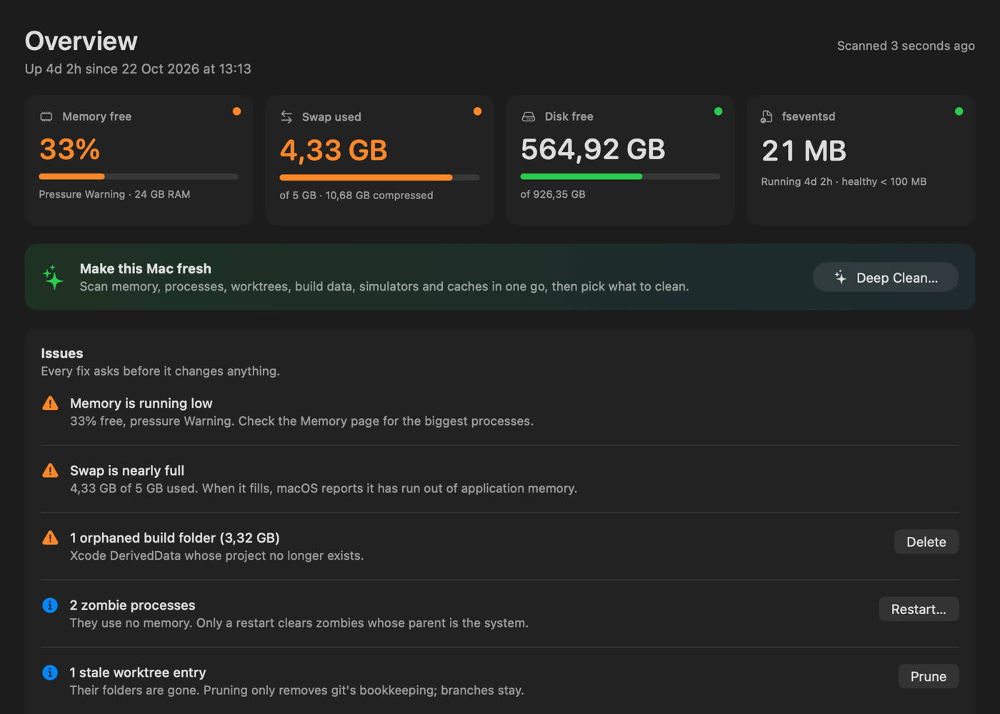
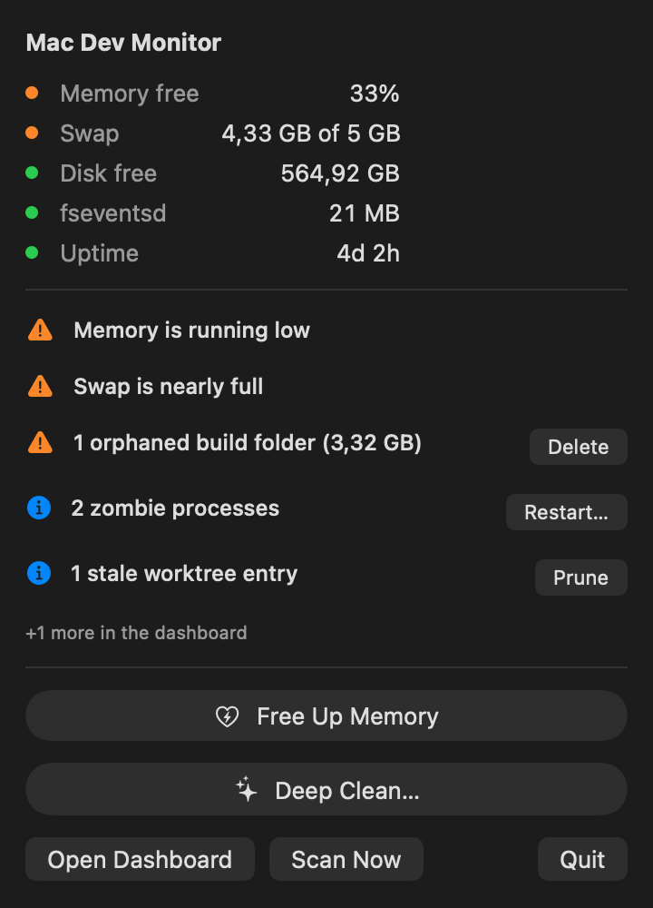
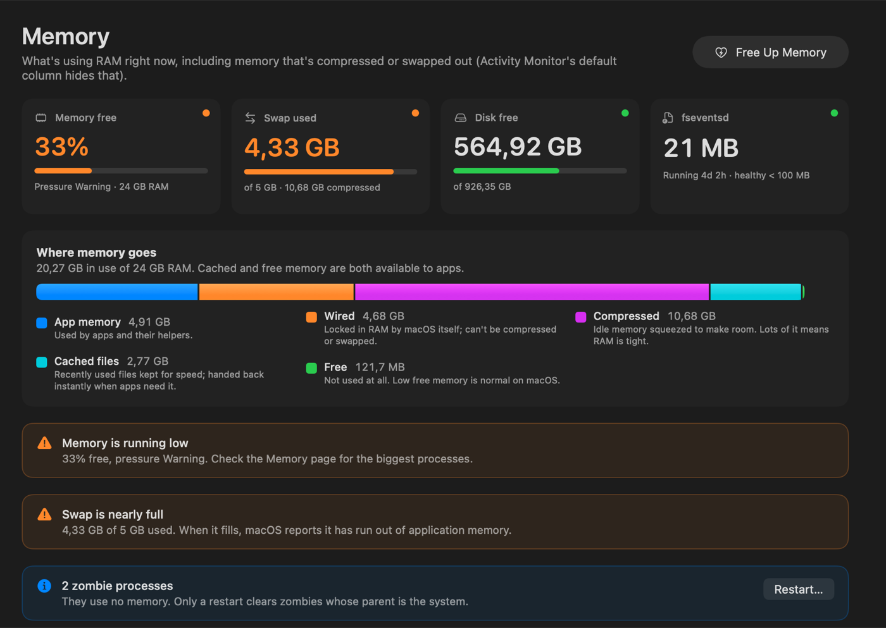
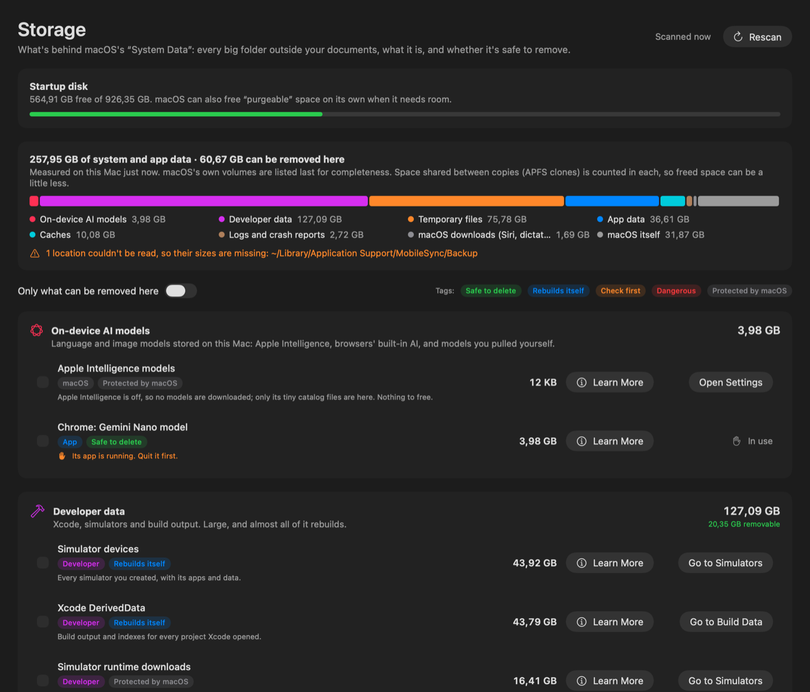
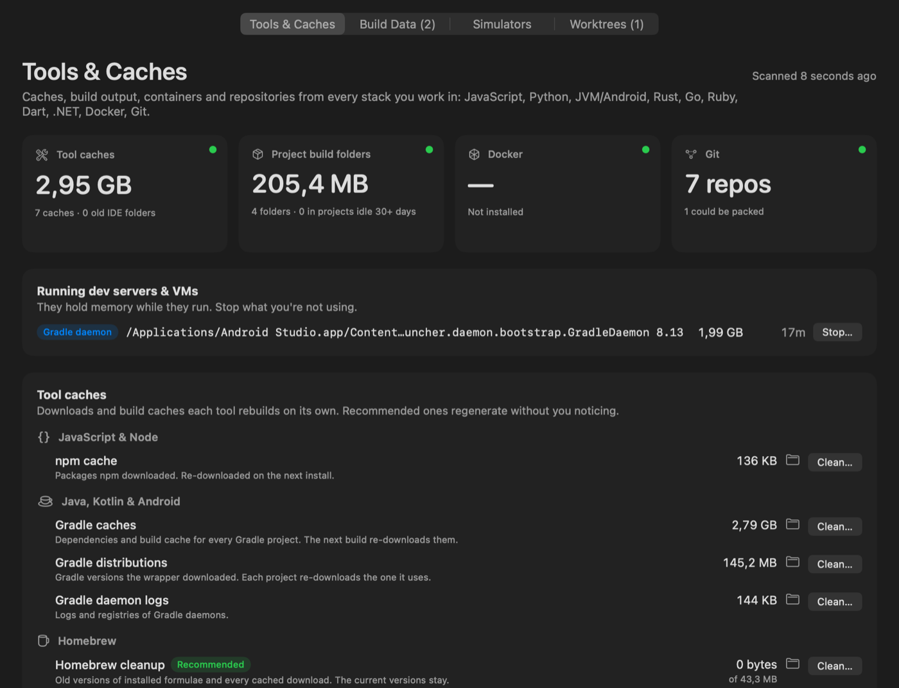
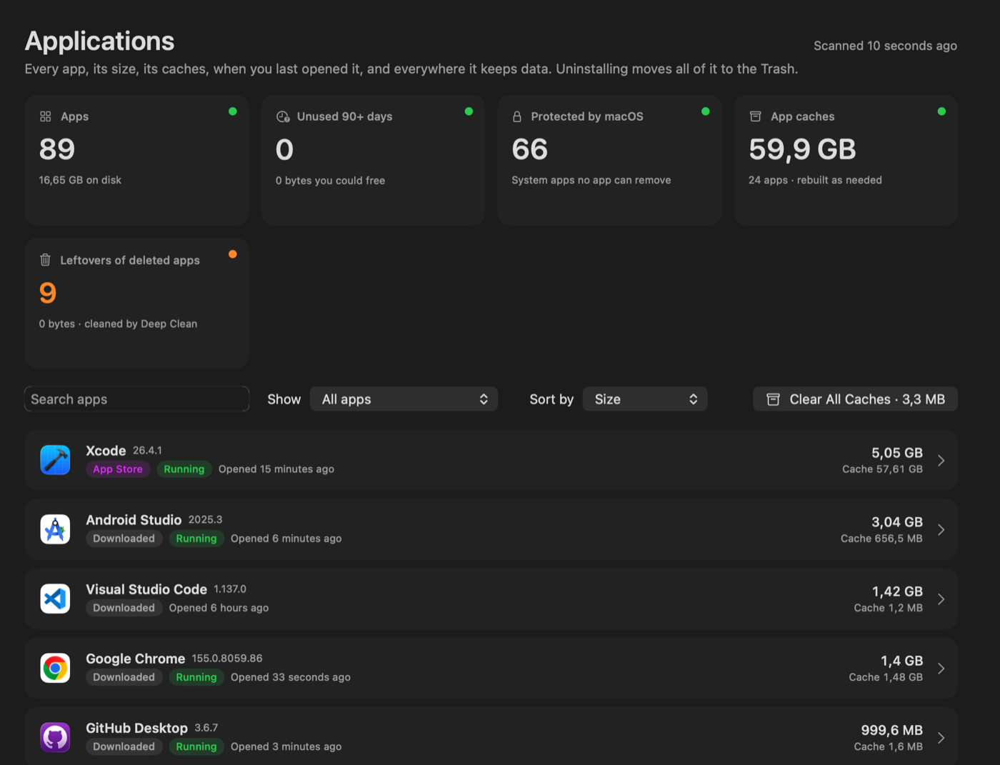
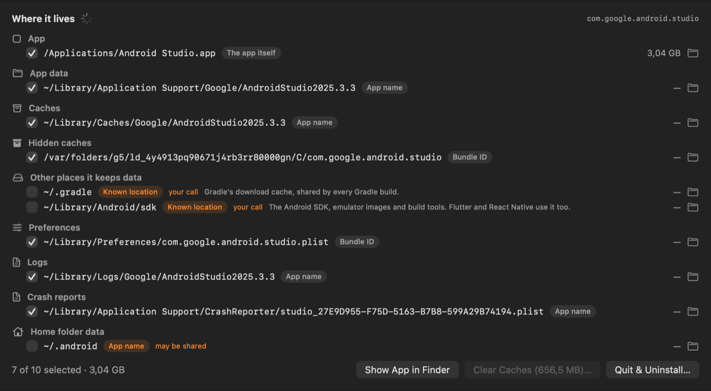
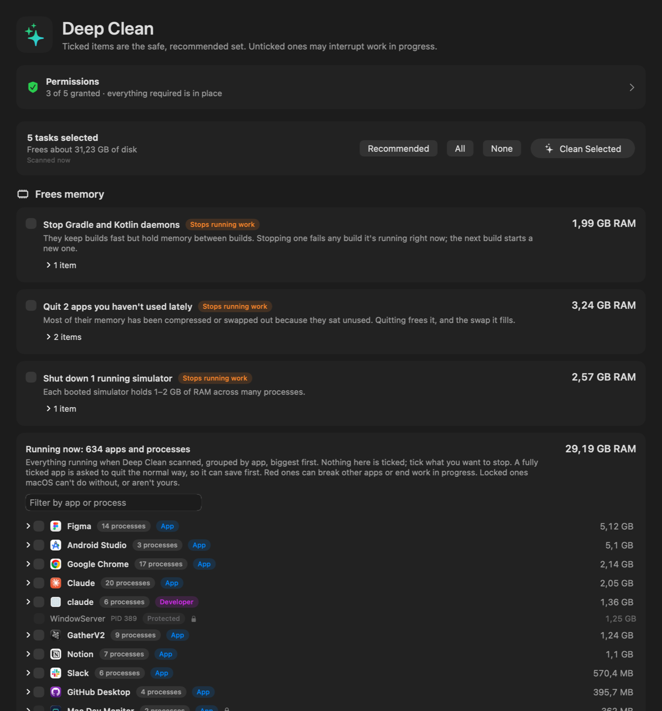

# Mac Dev Monitor

### Your Mac is crawling. Let's find out who's to blame.

Swap full, fans spinning, "Your system has run out of application memory"… and Activity Monitor just shrugs.
Mac Dev Monitor checks every corner of your Mac, names what's eating your RAM and disk, explains it in plain words,
and cleans up only what you tick.

> [!IMPORTANT]
> **🤖 Claude built this app, not me.**
> Every line of Swift, every test, the README you're reading and the screenshots below were made by
> [Claude](https://claude.com/claude-code) (Anthropic's AI) in Claude Code. I described what my Mac was doing,
> answered "go ahead", and Claude did the rest.

<p align="center"></p>

## What it does

| | |
|---|---|
| **🩺 Menu bar** — memory, swap, disk and the worst offenders at a glance, with Free Up Memory and Deep Clean one click away. |  |
| **🧠 Memory** — where your RAM really goes (including the compressed and swapped memory Activity Monitor hides), every process grouped by app with safe or dangerous badges, and a checklist to free memory. |  |
| **💽 Storage** — finally, what's inside "System Data": AI models, caches, logs, snapshots, simulators, installers. Each item is tagged *Safe*, *Rebuilds itself*, *Check first*, *Dangerous* or *Protected*, and removable where it's safe. |  |
| **🛠 Dev Tools** — npm, pip, Gradle, Cargo, CocoaPods, Homebrew and Docker caches, Xcode DerivedData, simulators, `node_modules` in idle projects, stale git worktrees. |  |
| **📦 Applications** — every app with its size, its caches and when you last opened it. |  |
| **🧹 Real uninstall** — finds *everything* an app leaves behind (containers, hidden caches, preferences, launch agents, Xcode's DerivedData…) and moves it to the Trash. |  |
| **✨ Deep Clean** — one scan of all of the above. Pick what to clean down to each folder and process, see how much memory and disk you got back. |  |

## Safe by default

- Nothing is removed until you tick it and confirm.
- Your data goes to the **Trash**. Only caches that rebuild themselves are deleted outright.
- Everything is checked again just before it's acted on, so busy builds, open apps and running sessions are left alone.
- macOS's own files are never touched. When a step needs an administrator, macOS asks for your password; the app never sees or stores it.

## Install

Download **Mac Dev Monitor.zip** from [Releases](../../releases/latest), unzip it and move the app to Applications.

It isn't notarized by Apple, so macOS blocks the first launch. Allow it once in
**System Settings › Privacy & Security › Open Anyway**, or run:

```bash
xattr -dr com.apple.quarantine "/Applications/Mac Dev Monitor.app"
```

For Storage to see everything, grant it **Full Disk Access** when it asks.

### Build from source

Requires macOS 14+ and Xcode 16 (Swift 6).

```bash
bash scripts/bundle.sh   # builds, signs ad hoc, installs to ~/Applications
swift test               # runs the test suite
```

Want every detail? See [docs/FEATURES.md](docs/FEATURES.md).

## License

[MIT](LICENSE)
